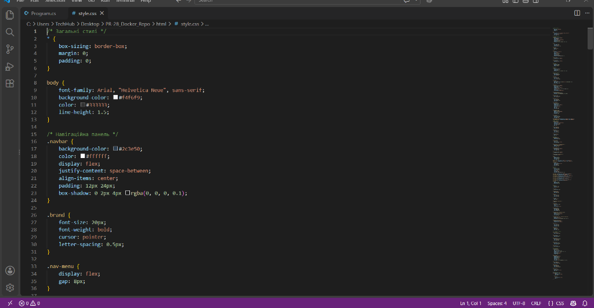
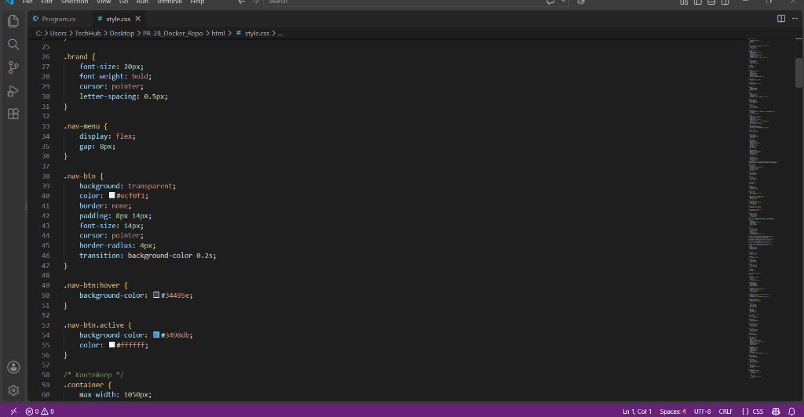
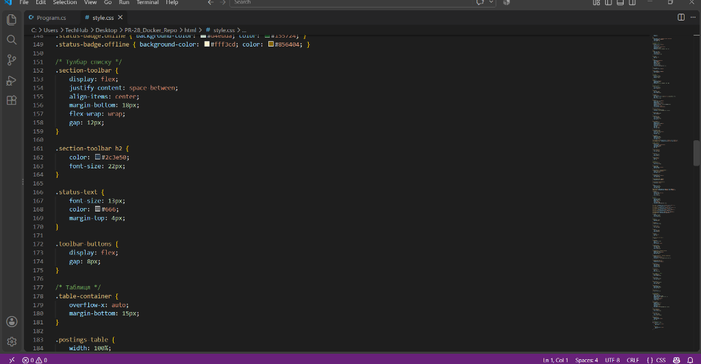
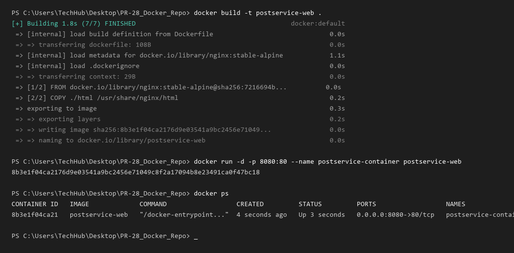
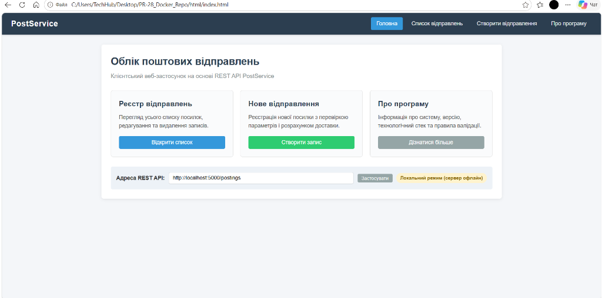

# ПР-28. Встановлення та налаштування docker контейнера

**Дисципліна:** Веб-програмування / Хмарні технології  
**Студентка:** Овдійчук Марія  

---

## Тема роботи
Встановлення та налаштування Docker-контейнера для розгортання веб-застосунку.

## Мета роботи
Опанувати основи контейнеризації веб-додатків за допомогою платформи Docker; навчитися писати конфігураційний файл `Dockerfile` на базі статичного сервера Nginx; опанувати команди побудови образу `docker build` та запуску контейнера `docker run` із перенаправленням мережевих портів (`-p 8080:80`); перевірити коректність функціонування інтерфейсу застосунку через веб-браузер.

---

## Хід роботи

### Крок 1. Підготовка структури проєкту та файлів клієнтської частини
У каталозі проєкту сформовано структуру директорії `html/`, яка містить розмітку (`index.html`), стильове оформлення (`style.css`) та логіку взаємодії (`app.js`). Розроблено сучасний адаптивний інтерфейс для системи обліку та моніторингу поштових відправлень "PostService":
- Реалізовано навігаційну панель з логотипом бренду та вкладками навігації;
- Налаштовано стилі кнопок дій, карток і форм введення;
- Створено стилізацію таблиці відправлень з кольоровими індикаторами статусів доставки.







---

### Крок 2. Створення маніфесту Dockerfile
Для контейнеризації веб-клієнта у корені репозиторію створено конфігураційний файл `Dockerfile` на базі легковагового Linux-дистрибутиву `nginx:stable-alpine`:
```dockerfile
FROM nginx:stable-alpine
COPY ./html /usr/share/nginx/html
EXPOSE 80
CMD ["nginx", "-g", "daemon off;"]
```
Також створено файл `.dockerignore` для виключення зайвих файлів та тимчасових системних логів з контексту збірки образу.

---

### Крок 3. Збірка образу та розгортання контейнера
За допомогою терміналу виконано побудову власного Docker-образу та запуск контейнера:
1. Збірка образу з тегом `postservice-web`:
   ```bash
   docker build -t postservice-web .
   ```
2. Запуск контейнера у фоновому (detached) режимі з публікацією порту `8080:80`:
   ```bash
   docker run -d -p 8080:80 --name postservice-container postservice-web
   ```
3. Моніторинг активних контейнерів та перевірка статусу працездатності:
   ```bash
   docker ps
   ```



---

### Крок 4. Тестування роботи веб-застосунку
Після успішного старту контейнера здійснено перевірку працездатності веб-інтерфейсу за мережевою адресою `http://localhost:8080`. Застосунок повністю завантажується через Nginx, відображає інтерактивну таблицю поштових відправлень, працює пошук, фільтрація за статусами та модальне вікно створення нового відправлення.



---

## Запитання для самоконтролю

### 1. В чому принципова різниця між віртуальною машиною та докер контейнером?
Віртуальна машина містить у собі повну операційну систему (зі своїм окремим ядром, системними службами та емульованим залізом), тому вона важить десятки гігабайт і довго вантажиться.  
Докер-контейнер не містить власної ОС — він використовує спільне ядро хостової системи (Linux) і ізолює лише сам додаток та потрібні бібліотеки. Через це контейнери важать лічені мегабайти, стартують за секунди і споживають мінімум оперативної пам'яті.

### 2. Що таке докер хост?
Докер хост (Docker Host) — це фізичний або віртуальний комп'ютер, на якому встановлена і працює фонова служба Докера (`dockerd`). Саме цей комп'ютер виділяє свої ресурси (процесор, пам'ять, дисковий простір і мережу) для збірки образів і запуску контейнерів.

### 3. Як видалити докер образ якщо він використовується в контейнері?
Якщо з образу створено контейнер (навіть якщо він зупинений), Докер не дозволить видалити образ просто так. Є два шляхи:
1. **Правильний:** спочатку зупинити й видалити цей контейнер (`docker stop <id>`, потім `docker rm <id>`), а вже потім видалити сам образ (`docker rmi <image_id>`);
2. **Примусовий:** видалити образ через прапорець force: `docker rmi -f <image_id>`.

### 4. В чому різниця між docker container, docker image та docker volume?
- **Docker Image (образ):** це статичний незмінний шаблон (як установочний образ ISO чи креслення), де запаковано програму з файлами;
- **Docker Container (контейнер):** це живий запущений екземпляр образу (працююча програма в процесах);
- **Docker Volume (том):** це окрема папка на диску хоста, яка підключається до контейнера для постійного збереження даних (наприклад, файлів чи бази даних), щоб вони не зникли після видалення або перезапуску контейнера.

### 5. Яка команда створює докер образ з докерфайла?
Команда `docker build`.  
Наприклад: `docker build -t postservice-web .`  
Де `-t` задає ім'я (тег) образу, а крапка `.` вказує на поточну папку, в якій лежить файл `Dockerfile`.

### 6. Яка інструкція в докерфайлі запускає програму яка буде виконуватись в контейнері?
Інструкція `CMD` (або `ENTRYPOINT`).  
Наприклад: `CMD ["nginx", "-g", "daemon off;"]`. Вона задає головну команду, яка стартує під час запуску контейнера (у нашому випадку — запуск веб-сервера Nginx у робочому режимі).

---

## Висновок
Під час виконання практичної роботи № 28 я опанувала концепцію контейнеризації додатків за допомогою Docker. Створила конфігурацію `Dockerfile` на базі легкового веб-сервера `nginx:stable-alpine`, скопіювала клієнтські файли веб-застосунку (`index.html`, `style.css`, `app.js`), зібрала власний Docker-образ та розгорнула ізольований контейнер з перенаправленням порту `8080:80`. Роботу розгорнутого веб-інтерфейсу успішно перевірено у браузері.
